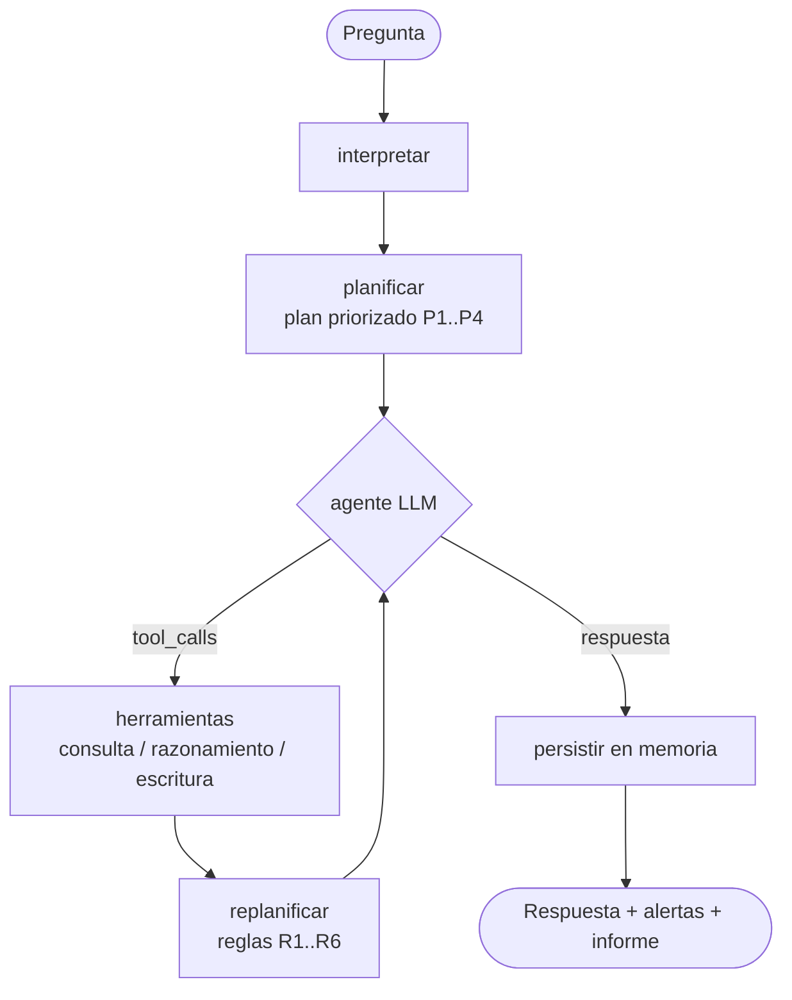

# Insight Trader: agente copiloto de inversiones explicable

Agente de IA construido con **LangGraph + LangChain**. Asiste a los asesores de una fintech recomendando qué hacer con cada posición de un cliente (mantener, reducir o no operar). Para eso:

- **Consulta** el portafolio, el mercado, las noticias y la memoria.
- **Razona** sobre el riesgo y la concentración.
- **Escribe** alertas, informes y preferencias.

El agente planifica sus tareas por prioridad, **re-planifica** cuando cambian las condiciones (shock de mercado, datos desactualizados, activo inválido) y mantiene **memoria de corto y largo plazo** entre conversaciones.

Proyecto académico, asignatura "Ingeniería de Soluciones con IA" (ISY0101).

- Evaluación Parcial 1: pipeline RAG de fuentes duales.
- Evaluación Parcial 2: agente funcional.
- Evaluación Parcial 3: **observabilidad** del agente: trazas, métricas, análisis de registros, dashboard y seguridad. Ver [`docs/observabilidad.md`](docs/observabilidad.md).

## Problema organizacional

Las fintech que ofrecen trading asistido por IA enfrentan dos problemas:

1. **Confianza y regulación.** Los clientes reciben recomendaciones sin entender por qué.
2. **Operación.** Los asesores no alcanzan a revisar a diario cada portafolio frente a un mercado que cambia.

El agente automatiza esa revisión. En cada caso:

- Cita los datos que respaldan cada recomendación.
- Respeta el perfil de riesgo y las preferencias del cliente.
- Alerta al asesor humano cuando detecta un riesgo.
- Se abstiene de recomendar cuando los datos no son confiables.

## Arquitectura en una imagen



En [`docs/architecture.md`](docs/architecture.md) están el detalle de componentes, el diagrama de secuencia, las herramientas, las reglas de re-planificación, la memoria y la justificación de cada componente.

## Capacidades del agente

| Capacidad | Implementación |
|---|---|
| **Herramientas de consulta** | `consultar_portafolio`, `consultar_mercado`, `buscar_noticias` (RAG FAISS), `recordar_memoria` |
| **Herramientas de razonamiento** | `evaluar_riesgo` (volatilidad vs. tolerancia), `evaluar_concentracion` (exposición vs. límite del perfil) |
| **Herramientas de escritura** | `registrar_alerta` (`outputs/alertas.jsonl`), `generar_informe` (`outputs/informes/*.md`), `guardar_preferencia` (SQLite) |
| **Memoria de corto plazo** | Checkpointer SQLite de LangGraph por `thread_id` (sobrevive a reinicios): preguntas de seguimiento como "¿y ahora?" |
| **Memoria de largo plazo** | SQLite con búsqueda semántica: recomendaciones previas y preferencias entre sesiones |
| **Planificación** | Plan inicial priorizado y re-planificación después de cada herramienta (reglas R0–R6) |
| **Condiciones cambiantes** | Escenarios `normal`, `shock` y `datos_desactualizados` (cambiables en mitad de la conversación) |
| **LLM real con respaldo** | API de NVIDIA (`nemotron-3.5-lightning`) → Ollama local (`qwen2.5:3b`) → modo degradado determinista. Limitador de tasa, reintentos con espera creciente y circuit breaker |
| **Embeddings neuronales** | `embeddinggemma` vía Ollama para el RAG y la memoria (hashing solo como respaldo) |
| **Observabilidad (EP3)** | Trazas por turno (nodos, herramientas, LLM, tokens, CPU/RAM), logs JSON, banco de evaluación, métricas, análisis automático y dashboard |
| **Seguridad (EP3)** | Guardrail de entrada (prompt injection), guardrail de salida (reglas duras), enmascaramiento de datos personales y seudónimos |

## Estructura del repositorio

```
src/insight_trader/
  agent/                      # Agente funcional (EP2)
    graph.py                  #   Grafo LangGraph + fachada InsightTraderAgent
    planner.py                #   Plan priorizado y reglas de re-planificación
    tools.py                  #   9 herramientas (consulta / razonamiento / escritura)
    llm.py                    #   Prompt, router de proveedores (NVIDIA/Ollama/degradado), limitador de tasa
    guardrails.py             #   Guardrails de entrada y salida (EP3)
    memory.py                 #   Memoria de largo plazo (SQLite + búsqueda semántica)
    environment.py            #   Entorno de mercado con escenarios
    cli.py                    #   CLI para la demo en vivo
    server.py                 #   API HTTP para la vista web
  observability/              # Observabilidad (EP3)
    tracing.py                #   TraceCollector (callbacks) y monitor de CPU/RAM
    store.py                  #   trazas.jsonl y log JSON estructurado
    privacy.py                #   Enmascaramiento de datos personales, seudonimos, prompt injection
    evaluation.py             #   Banco de evaluacion (24 casos con variabilidad de datos)
    metrics.py                #   Precision, consistencia, errores, latencia, recursos
    analysis.py               #   Deteccion automatica de cuellos de botella y anomalias
    report.py                 #   Datos del dashboard
  agents/                     # Pipeline de la EP1 (se reutiliza el AnalysisAgent)
  rag/                        # RAG de fuentes duales con FAISS (EP1)
  data/                       # Datos simulados: 3 clientes, mercado, noticias
docs/
  architecture.md             # Diagramas de orquestación y justificación de componentes
  evidencia_escenarios.md     # Traza real de 6 escenarios de decisión (autogenerado)
  documentacion_tecnica.md    # Documentación de la EP1
  observabilidad.md           # Observabilidad, métricas, resultados y mejoras (EP3)
  analisis_registros.md       # Reporte del análisis automático de trazas (autogenerado)
  prompts.md                  # Diseño de prompts (EP1)
scripts/
  demo_escenarios.py          # Regenera docs/evidencia_escenarios.md
  export_agent_demo.py        # Exporta conversaciones para el modo grabado web
  export_demo_data.py         # Exporta respuestas del pipeline de la EP1 a JSON
  exportar_observabilidad.py  # Exporta metricas y trazas al dashboard (EP3)
tests/                        # 59 pruebas automatizadas (pytest)
web-react/                    # App React: interfaz del agente (EP2)
  src/agent/                  #   Vista del agente: chat, plan, herramientas, re-planificación
web/                          # Vista HTML simple de la EP1
```

## Instalación

Requiere Python 3.10 o superior. En Windows (PowerShell):

```powershell
python -m venv .venv
.venv\Scripts\Activate.ps1
pip install -r requirements.txt
pip install -e .
```

En Git Bash, Linux o macOS, activar con `source .venv/Scripts/activate` o `source .venv/bin/activate`.

### LLM y embeddings (EP3)

1. Copia `.env.example` como `.env` y completa `NVIDIA_API_KEY` (clave gratuita en [build.nvidia.com](https://build.nvidia.com)). El `.env` está en `.gitignore`.
2. Instala [Ollama](https://ollama.com) y descarga los modelos locales:

```powershell
ollama pull embeddinggemma:300m   # embeddings del RAG y la memoria
ollama pull qwen2.5:3b            # respaldo local si NVIDIA no responde
```

Sin clave de NVIDIA ni Ollama el agente igual funciona: cae al modo degradado (planificador determinista) y a embeddings por hashing, y lo registra en la traza.

## Ejecución

### Vista web "Agente en vivo" (recomendada para la demo)

Se necesitan dos terminales, ambas desde la carpeta del proyecto.

```powershell
# Terminal 1: API del agente (Python, solo librería estándar)
.venv\Scripts\Activate.ps1
python -m insight_trader.agent.server

# Terminal 2: interfaz web (React + Vite)
cd web-react
npm install        # solo la primera vez
npm run dev
```

Abre la URL que muestra Vite (normalmente http://localhost:5173). La vista muestra:

- La conversación con el agente.
- El **plan de tareas** como checklist que se va completando.
- Cada **llamada a herramienta** con su resultado (clic para ver el JSON).
- Las **re-planificaciones** (reglas R0–R6).
- La recomendación final con alertas.

En la barra lateral se puede:

- **Ver "Recomendaciones"**: la acción sugerida para cada posición de cada cliente según la condición de mercado, ordenada por urgencia y con la misma regla de decisión del agente (sin generar alertas ni memoria). Cada fila tiene un botón **"Preguntar al agente"** que abre el chat del cliente con ese escenario.
- **Cambiar de cliente.**
- **Crear un cliente nuevo** con el botón **+**: nombre, perfil de riesgo, tolerancia, horizonte y portafolio (solo activos con datos de mercado, con pesos que sumen 100%). Los clientes creados se guardan en `outputs/clientes/` (fuera de git) y se pueden eliminar desde "Contexto del cliente".
- **Abrir el panel de cada simulación de mercado** (normal, shock o datos desactualizados). Cada panel muestra:
  - indicadores clave, una tabla de activos con la variación frente al mercado normal y un gráfico de volatilidad,
  - el impacto en cada cliente (qué posiciones superan su tolerancia),
  - las noticias del escenario,
  - una referencia de **mercado real** obtenida en vivo desde la API pública de Yahoo Finance (precio, variación semanal y gráfico de 30 días).

  El botón **"Usar este escenario en el chat"** cambia la condición con la que responde el agente. Los datos reales son solo referencia: el agente trabaja con el feed simulado para que la demo sea reproducible.
- **Leer las secciones informativas**, arriba de "Nueva conversación":
  - *¿Cómo funciona?*: flujo, herramientas, memoria y decisiones de diseño.
  - *¿Para qué sirve?*: problema, público objetivo y alcance.
  - *¿Qué evaluamos?*: variables, reglas R0–R6, escenarios y glosario.
  - *¿Cómo te beneficia?*: beneficios, buenas prácticas, riesgos y limitaciones.

Si la API no está corriendo (por ejemplo, en el despliegue estático de Vercel), la página entra en **modo grabado** y reproduce conversaciones reales exportadas con `python scripts/export_agent_demo.py`.

### 1. Una pregunta (muestra el plan, las herramientas, la re-planificación y la respuesta)

```powershell
python -m insight_trader.agent.cli --client valentina_rojas "Que hago con TSLA?"
python -m insight_trader.agent.cli --client diego_herrera --escenario datos_desactualizados "Que hago con BND?"
python -m insight_trader.agent.cli --client constanza_fuentes "Revisa mi portafolio completo"
```

### 2. Conversación interactiva (memoria de corto plazo + cambio de condiciones en vivo)

```powershell
python -m insight_trader.agent.cli --client valentina_rojas --reset-memoria
```

```
Tu> Que hago con TSLA?                 -> mantener (volatilidad 21.8% < tolerancia 30%)
Tu> /escenario shock                   -> cambia el entorno de mercado
Tu> Y ahora, con la caida del mercado? -> reducir; alerta crítica; explica que CAMBIA la recomendación anterior
Tu> /memoria                           -> muestra lo guardado en memoria de largo plazo
Tu> /salir
```

Para probar la memoria entre sesiones:

1. Cierra la CLI y vuelve a abrirla con `--client constanza_fuentes`.
2. Escribe `Recuerda que no quiero aumentar mi exposicion a cripto`.
3. Cierra, vuelve a abrir y pregunta `Que hago con ETH?`. El agente recuerda la preferencia.

| Parámetro | Valores |
|---|---|
| `--client` | `constanza_fuentes` (moderado, 12%), `diego_herrera` (conservador, 6%), `valentina_rojas` (agresivo, 30%) |
| `--escenario` | `normal`, `shock`, `datos_desactualizados` |
| `--thread` | Id de la conversación (cada una tiene su propia memoria de corto plazo) |
| `--reset-memoria` | Borra la memoria de largo plazo del cliente |
| `--breve` | Muestra solo la respuesta |

### 3. Escenarios de evidencia y pruebas

```powershell
python scripts/demo_escenarios.py   # regenera docs/evidencia_escenarios.md
python -m pytest -q                 # 59 pruebas
```

### 4. Observabilidad (EP3)

```powershell
# Banco de evaluacion: 24 casos x N repeticiones con una configuracion dada
python -m insight_trader.observability.evaluation --etiqueta determinista --cadena mock --reps 2
$env:INSIGHT_TRADER_MEJORAS = "off"  # medicion "antes" (las mejoras vienen activas por defecto)
python -m insight_trader.observability.evaluation --etiqueta nvidia --cadena nvidia,mock --reps 3
python -m insight_trader.observability.evaluation --etiqueta nvidia_sin_guardrail --cadena nvidia,mock --guardrail off
$env:INSIGHT_TRADER_MEJORAS = "on"   # medicion "despues"
python -m insight_trader.observability.evaluation --etiqueta nvidia_mejorado --cadena nvidia,mock --reps 3

# Analisis automatico de registros (cuellos de botella, atipicos, patrones de error)
python -m insight_trader.observability.analysis

# Exporta metricas y trazas al dashboard y a docs/analisis_registros.md
python scripts/exportar_observabilidad.py
```

Cada turno del agente (CLI, web o evaluación) deja su traza en `outputs/observabilidad/trazas.jsonl` y un evento en el log JSON `outputs/observabilidad/agente.log`. El dashboard está en la sección **Observabilidad** de la web (o directo en `/#observabilidad`): en vivo si la API está corriendo, o con la última exportación en Vercel.

### 5. Elegir el proveedor de LLM

`INSIGHT_TRADER_LLM_CHAIN` define la cadena (por defecto `nvidia,ollama,mock`). Las pruebas fijan `mock` (planificador determinista) para ser rápidas y reproducibles. Claude sigue disponible como `anthropic` (requiere `pip install langchain-anthropic` y `ANTHROPIC_API_KEY`). Las reglas de seguridad (R1–R6) viven en el planificador y en el guardrail de salida, no en el LLM, así que se cumplen con cualquier proveedor.

## Escenarios de toma de decisiones

| # | Situación | Comportamiento del agente |
|---|---|---|
| 1 | Misma pregunta sobre TSLA, cliente moderado vs. agresivo | Moderado: **reducir** + alerta alta + revisa concentración. Agresivo: **mantener** sin alertas |
| 2 | Shock de mercado en mitad de la conversación | Hereda el activo del turno anterior, agrega una alerta **crítica** y explica que la recomendación **cambia** respecto a la anterior |
| 3 | Feed de precios con 72 h de antigüedad | Cancela la evaluación de riesgo y las noticias, alerta y responde **no operar** |
| 4 | Preferencia guardada en una sesión anterior | Una nueva instancia del agente la recupera de SQLite y no recomienda aumentar la exposición |
| 5 | Activo que el cliente no posee (NVDA) | La validación P1 falla y cancela el resto del plan |
| 6 | Revisión de todo el portafolio | Evalúa por peso, prioriza alertas y ordena qué reducir primero (menor margen primero) |

La traza completa de cada escenario (herramientas, decisiones y plan final) está en [`docs/evidencia_escenarios.md`](docs/evidencia_escenarios.md).

## Pruebas

`tests/test_agent.py` verifica:

- La presencia de las tres familias de herramientas.
- Los archivos que escriben las herramientas de escritura.
- El orden del plan.
- Que cada escenario adaptativo produce la decisión esperada.
- El aislamiento de la memoria de corto plazo entre conversaciones.
- La persistencia de la memoria de largo plazo entre instancias.
- El ranking semántico de la memoria.

Las pruebas de la EP1 (`test_retriever.py`, `test_analysis_agent.py`, `test_orchestrator.py`) siguen pasando.

## Datos

Todos los datos de `src/insight_trader/data/` son **simulados** para fines académicos:

- 3 clientes con perfiles de riesgo distintos.
- Un feed de mercado al estilo Chainlink Price Feeds.
- Noticias con sentimiento.

Las salidas del agente (alertas, informes y memoria) se escriben en `outputs/`, que no se versiona.
