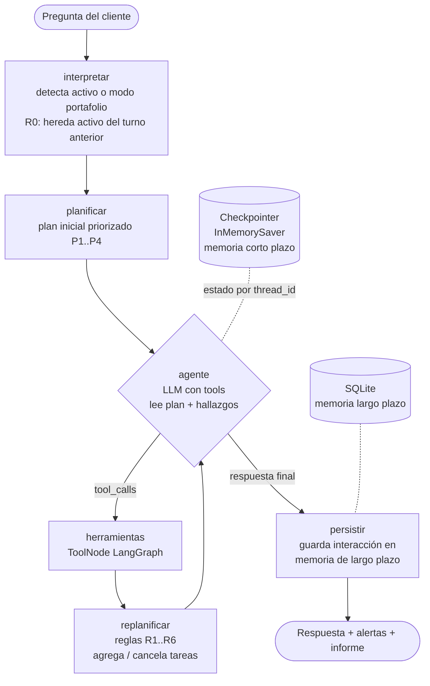
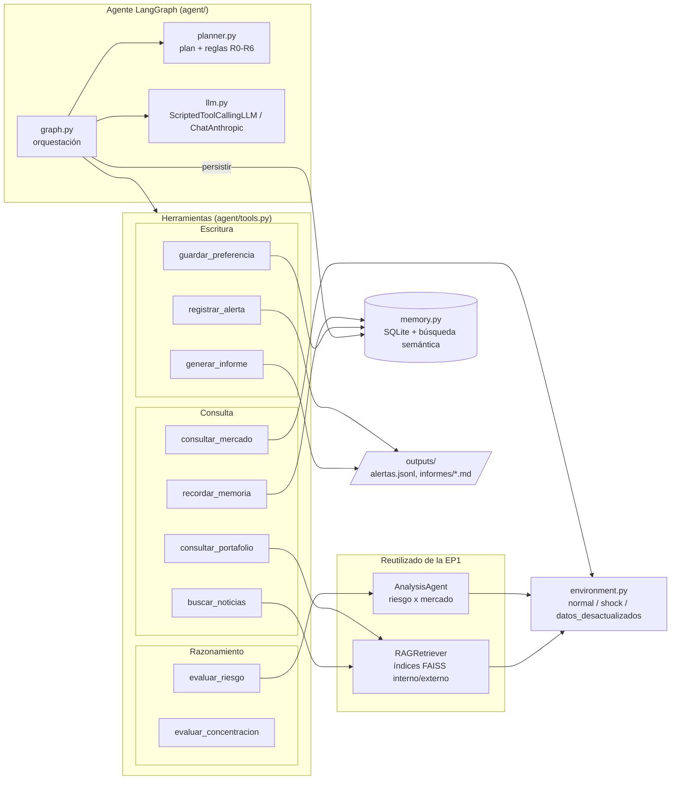
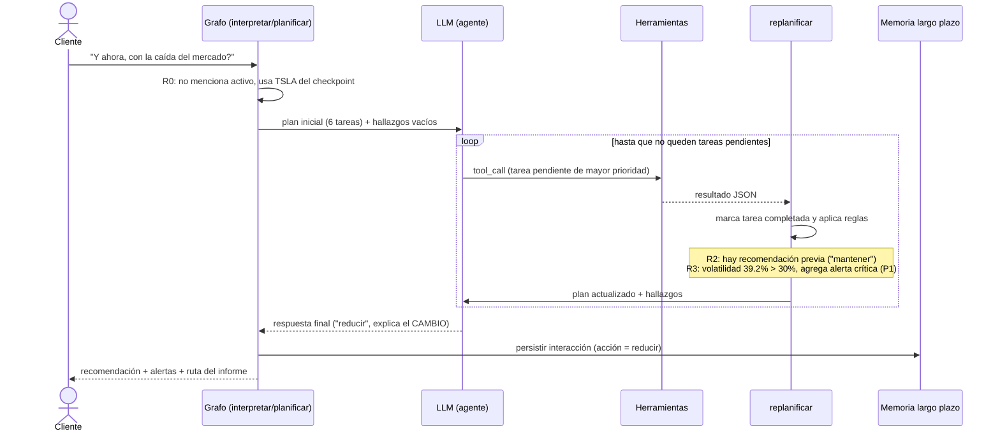
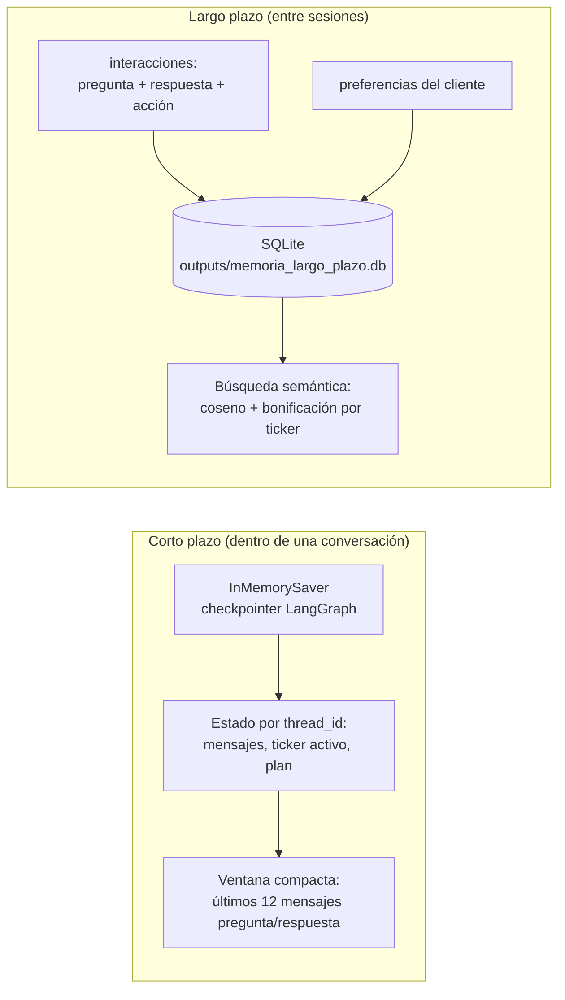

# Arquitectura del agente Insight Trader

Este documento describe la arquitectura del **agente funcional** (Evaluación Parcial 2) y cómo se integra con el pipeline RAG construido en la Evaluación Parcial 1.

- Sección 1: diagrama de orquestación (grafo LangGraph).
- Sección 2: componentes y cómo se integran.
- Sección 3: secuencia de un turno.
- Sección 4: herramientas.
- Sección 5: planificación y re-planificación.
- Sección 6: memoria.
- Sección 7: justificación de cada componente.

## 1. Diagrama de orquestación (grafo de estados LangGraph)

El agente es un `StateGraph` de LangGraph ([`agent/graph.py`](../src/insight_trader/agent/graph.py)). Cada nodo lee y escribe un estado compartido (`AgentState`). Un checkpointer guarda ese estado por conversación (`thread_id`).

Lo que este diseño aporta frente a la EP1, que era una secuencia fija recuperación → análisis → generación:

- **El ciclo agente ↔ herramientas ↔ replanificar.** El número de pasos y las herramientas que se usan dependen de lo que el agente observa en cada iteración.
- **El estado persiste entre turnos** gracias al checkpointer.

## 2. Componentes y su integración

| Componente | Archivo | Responsabilidad |
|---|---|---|
| Orquestador | `agent/graph.py` | Define el grafo, el estado y la fachada `InsightTraderAgent.ask()` |
| Planificador | `agent/planner.py` | Arma el plan inicial priorizado y lo ajusta después de cada herramienta |
| Herramientas | `agent/tools.py` | 9 `StructuredTool` de LangChain que devuelven JSON |
| LLM | `agent/llm.py` | Prompt de sistema, LLM simulado con tool calling y conector a Claude |
| Memoria largo plazo | `agent/memory.py` | Persistencia SQLite y recuperación semántica de interacciones y preferencias |
| Entorno | `agent/environment.py` | Datos de mercado con escenarios que cambian las condiciones |
| RAG (EP1) | `rag/retriever.py` | Recuperación híbrida (filtro por ticker + similitud) sobre dos índices FAISS |
| Análisis (EP1) | `agents/analysis_agent.py` | Señal estructurada que cruza riesgo con mercado |

## 3. Secuencia de un turno

Ejemplo: escenario de shock, pregunta de seguimiento sin activo.

## 4. Herramientas

| Tipo | Herramienta | Qué hace | Fuente |
|---|---|---|---|
| Consulta | `consultar_portafolio(ticker)` | Valida la posición, entrega el perfil de riesgo y las transacciones vía RAG interno | `clients/*.json` + FAISS interno |
| Consulta | `consultar_mercado(ticker)` | Precio, cambio y volatilidad a 7 días, tendencia y **frescura del dato** | Entorno (feed simulado) |
| Consulta | `buscar_noticias(ticker, consulta)` | Noticias vía RAG externo, con sentimiento | FAISS externo |
| Consulta | `recordar_memoria(consulta, ticker)` | Recuerdos semánticos, recomendación previa y preferencias | SQLite |
| Razonamiento | `evaluar_riesgo(ticker)` | Volatilidad vs. tolerancia, margen y excedencia | `AnalysisAgent` |
| Razonamiento | `evaluar_concentracion()` | Exposición por clase de activo vs. límite del perfil | Portafolio |
| Escritura | `registrar_alerta(ticker, motivo, severidad)` | Alerta para el asesor humano | `outputs/alertas.jsonl` |
| Escritura | `generar_informe(ticker, recomendacion, justificacion)` | Informe Markdown trazable | `outputs/informes/` |
| Escritura | `guardar_preferencia(preferencia)` | Persiste una restricción del cliente | SQLite |

El LLM recibe el esquema de cada herramienta, que LangChain genera a partir de su docstring y sus type hints. Todas las herramientas devuelven JSON para que el planificador pueda leer el resultado sin parsear texto libre.

## 5. Planificación y re-planificación

### Prioridades del plan inicial

| Prioridad | Significado | Tareas típicas |
|---|---|---|
| P1 crítica | Validación, contexto y alertas de riesgo | `consultar_portafolio`, `recordar_memoria`, `consultar_mercado`, `registrar_alerta` |
| P2 alta | Evidencia principal para decidir | `evaluar_riesgo` |
| P3 media | Contexto complementario | `buscar_noticias`, `evaluar_concentracion` |
| P4 cierre | Escritura del resultado | `generar_informe` |

`consultar_portafolio` va primero porque, si el cliente no tiene el activo, el resto del plan no tiene sentido. `generar_informe` va al final porque necesita todos los hallazgos.

En **modo portafolio** ("revisa mi portafolio"), el plan evalúa cada posición de **mayor a menor peso**, para atender primero lo que más impacta.

### Reglas de re-planificación

Después de cada herramienta, `planner.replan()` aplica estas reglas y registra cada decisión en `plan_log`:

| Regla | Condición observada | Ajuste del plan / decisión |
|---|---|---|
| R0 contexto | La pregunta no menciona un activo | Hereda el activo del turno anterior (memoria de corto plazo) |
| R1 validación | El activo no está en el portafolio | Cancela todas las tareas restantes y responde sin recomendar |
| R2 memoria | Existe una recomendación previa para el activo | La respuesta debe decir si la decisión cambia y por qué |
| R3 riesgo | Volatilidad > tolerancia del cliente | Agrega `registrar_alerta` P1 (severidad *crítica* si cae ≤ −10%) y `evaluar_concentracion` P3 |
| R4 datos | El feed tiene más de 24 h de antigüedad | Cancela `evaluar_riesgo` y `buscar_noticias`, agrega una alerta y fija la decisión en "no operar" |
| R5 concentración | Exposición tech/cripto > límite del perfil (25/40/70%) | Agrega `registrar_alerta` P2 de concentración |
| R6 preferencia | Una preferencia guardada aplica al activo | La recomendación no puede aumentar la exposición |

La evidencia de cada regla, ejecutada sobre escenarios reales, está en [`evidencia_escenarios.md`](evidencia_escenarios.md). Las pruebas que la verifican están en [`tests/test_agent.py`](../tests/test_agent.py).

## 6. Memoria

- **Corto plazo.** El checkpointer guarda el estado completo del grafo por `thread_id`, lo que permite preguntas de seguimiento ("¿y ahora?"). Al LLM solo se le envían las preguntas y respuestas finales de los turnos anteriores (sin las llamadas a herramientas), con una ventana de 12 mensajes. Esto evita que el prompt crezca sin límite en conversaciones largas.
- **Largo plazo.** Cada respuesta se persiste en SQLite junto con la acción recomendada. Las preferencias se guardan con `guardar_preferencia`. `recordar_memoria` las recupera por similitud coseno, priorizando el mismo ticker (+0,3 al score).
- **Recuperación semántica.** La memoria usa la misma función de embeddings que el RAG de la EP1. Si se reemplaza por un modelo neuronal (`HuggingFaceEmbeddings`, `OpenAIEmbeddings`), mejoran ambos sin cambiar las clases.

## 7. Justificación de componentes

| Componente | Requisito del flujo que resuelve | Por qué este y no otro |
|---|---|---|
| **LangGraph** (`StateGraph`, `ToolNode`, checkpointer) | Ciclo agente ↔ herramientas con un paso de re-planificación explícito, y estado persistente por conversación | Un `AgentExecutor` clásico de LangChain no permite insertar un nodo propio (`replanificar`) entre la ejecución de las herramientas y la siguiente decisión del LLM. LangGraph modela el flujo como un grafo explícito, auditable y extensible (agregar un nodo de aprobación humana es agregar una arista) |
| **LangChain `@tool`** | Que el LLM conozca qué hace cada herramienta y sus argumentos | Genera el esquema JSON desde el docstring. Es compatible con cualquier chat model que soporte tool calling (Claude, GPT, Gemini, Ollama) |
| **Planificador por reglas + LLM** | Decisiones auditables en un dominio regulado (finanzas) | Las reglas críticas (no operar con datos viejos, alertar sobre la tolerancia) no deben depender de que el LLM las "recuerde". El LLM ejecuta y redacta; el plan garantiza los controles |
| **SQLite** para la memoria de largo plazo | Persistir preferencias e historial entre sesiones | Viene en la biblioteca estándar de Python (cero infraestructura) y es transaccional. Escala a Postgres/pgvector cambiando solo `memory.py` |
| **FAISS + recuperación híbrida** (EP1) | Recuperar evidencia del activo correcto | El filtro por ticker evita mezclar activos y el ranking semántico ordena dentro del filtro |
| **Escenarios de entorno** | Demostrar adaptación ante condiciones cambiantes de forma reproducible | Permiten repetir la demo en vivo y en las pruebas con el mismo resultado |
| **LLM simulado + Claude intercambiable** | Ejecutar sin costo ni API key y, a la vez, estar listo para producción | Ambos implementan `BaseChatModel` y leen el mismo prompt, así que el grafo no cambia. El simulado hace las pruebas deterministas |

### Escalabilidad y compatibilidad

- **Nuevas herramientas.** Agregar una función `@tool` en `build_tools` y, si corresponde, una regla en `replan`.
- **Nuevo proveedor de LLM.** Cualquier `BaseChatModel` con `bind_tools`.
- **Persistencia distribuida.** Reemplazar `InMemorySaver` por `SqliteSaver` o `PostgresSaver` de LangGraph, y SQLite por Postgres.
- **Multi-cliente.** Una instancia del agente por cliente, sin estado global. Las conversaciones se aíslan por `thread_id`.

### Limitaciones conocidas

- Los embeddings por hashing no capturan sinónimos: "cripto" y "Ethereum" no son cercanos. Mitigación: filtro por ticker y bonificación por ticker en la memoria.
- La memoria de corto plazo (`InMemorySaver`) se pierde al reiniciar el proceso. La de largo plazo no.
- Con un LLM real, el modelo podría llamar herramientas fuera del plan. `replanificar` lo registra como "acción no planificada" e incorpora el resultado, y el límite de 25 pasos evita los bucles.
