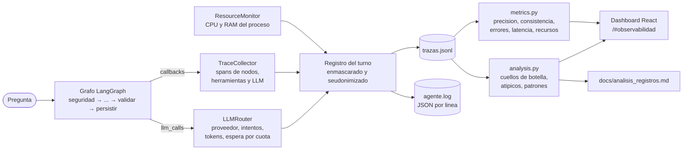

# Observabilidad del agente Insight Trader (EP3)

Este documento describe cómo se instrumentó el agente de la EP2 para medir su comportamiento en producción: qué se registra, qué métricas se calculan, cómo se analizan los registros, qué muestra el dashboard y qué controles de seguridad y privacidad se integraron. Al final están los resultados medidos y las correcciones que salieron de ellos.

- Sección 1: arquitectura de observabilidad.
- Sección 2: qué registra cada traza.
- Sección 3: métricas (IE1, IE2).
- Sección 4: banco de evaluación con variabilidad de datos.
- Sección 5: análisis de registros (IE3).
- Sección 6: dashboard (IE4).
- Sección 7: seguridad, privacidad y uso responsable (IE8).
- Sección 8: resultados.
- Sección 9: hallazgos y correcciones (IE6, IE7).
- Sección 10: cómo reproducir.

## 1. Arquitectura de observabilidad

| Componente | Archivo | Qué hace |
|---|---|---|
| `TraceCollector` | `observability/tracing.py` | Callback de LangChain: LangGraph le notifica el inicio y fin de cada nodo, herramienta y llamada al LLM. Arma los spans (inicio relativo, duración, estado, padre) |
| `ResourceMonitor` | `observability/tracing.py` | Muestrea cada 100 ms la memoria RSS del proceso y mide el tiempo de CPU del turno |
| `LLMRouter` | `agent/llm.py` | Registra por llamada: proveedor, modelo, latencia, tokens, espera por cuota, reintentos y fallos |
| `TraceStore` | `observability/store.py` | Escribe una línea JSON por turno en `outputs/observabilidad/trazas.jsonl` y el log estructurado `agente.log` (rotado a 5 MB) |
| `metrics.py` | `observability/metrics.py` | Calcula las métricas solo a partir de las trazas |
| `analysis.py` | `observability/analysis.py` | Detecta automáticamente cuellos de botella, atípicos, arranque en frío, patrones de error e inconsistencias |
| `report.py` | `observability/report.py` | Arma los datos del dashboard (API en vivo y exportación estática) |

**¿Por qué una solución propia y no LangSmith o Langfuse?** El mecanismo es el mismo (callbacks de LangChain), pero LangSmith envía las trazas a un servicio externo y Langfuse requiere desplegar su servidor. En un dominio financiero, las trazas contienen información sensible: guardarlas en local, ya enmascaradas, cumple el principio de minimización de datos. El formato JSONL es fácil de migrar a OpenTelemetry o Langfuse si el sistema escala (ver sección 9).

## 2. Qué registra cada traza

Una línea por turno del agente (CLI, web o evaluación):

| Campo | Contenido |
|---|---|
| `trace_id`, `ts` | Identificador y fecha UTC |
| `cliente`, `hilo` | Seudónimos (hash con sal), nunca el id ni el nombre real |
| `pregunta`, `respuesta` | Texto con datos personales enmascarados |
| `accion`, `estado` | Acción clasificada (reducir, mantener, no_operar, sin_recomendacion, bloqueado...) y estado del turno (ok, degradado, bloqueado, error) |
| `proveedor`, `modelo`, `degradado` | Quién respondió y si fue un respaldo |
| `latencia_ms`, `llm_ms`, `herramientas_ms`, `espera_cuota_ms`, `nodos_ms` | Desglose del tiempo |
| `llm_detalle` | Cada llamada al LLM: latencia, tokens, herramientas pedidas, fallos previos |
| `tokens_entrada`, `tokens_salida` | Consumo del turno |
| `herramientas` | Cada herramienta con su duración y estado |
| `replanificaciones`, `plan_*` | Reglas R0–R6 aplicadas y estado final del plan |
| `guardrail` | Violaciones detectadas, si el guardrail corrigió, acción del LLM vs. acción de las reglas |
| `seguridad` | Patrones de prompt injection y tipos de datos personales detectados en la entrada |
| `eventos` | Anomalías: 429, timeout, error 5xx, circuito abierto, respuesta prematura, acción no planificada, herramienta fallida |
| `recursos` | CPU (% de un núcleo, segundos) y RAM (inicio y pico) |
| `spans` | La cascada completa del turno |
| `eval` | Solo en la evaluación: caso, categoría, repetición, acción esperada |

## 3. Métricas

| Métrica | Dimensión | Definición |
|---|---|---|
| **Precisión** | Precisión (IE1) | Turnos finales evaluados con acción igual a la esperada / turnos evaluados |
| **Precisión del LLM sin guardrail** | Precisión (IE1) | Igual, usando la acción que redactó el LLM antes de la corrección |
| **Precisión por categoría y escenario** | Variabilidad (IE1) | Precisión separada por tipo de caso y condición de mercado |
| **Consistencia** | Consistencia (IE1) | Por caso, proporción de repeticiones que coinciden con la acción más común; promedio entre casos |
| **Consistencia de herramientas** | Consistencia (IE1) | Igual, sobre la secuencia de herramientas ejecutadas |
| **Tasa de error / degradado / bloqueo** | Errores (IE1) | Turnos en cada estado / turnos |
| **Tasa de violación del LLM y de intervención del guardrail** | Errores (IE1) | Turnos donde el LLM violó una regla dura / donde el guardrail la corrigió |
| **Eventos por tipo** | Errores (IE1) | Conteo y turnos afectados |
| **Latencia p50 / p95 / p99** | Latencia (IE2) | Del turno, por nodo, por herramienta y por llamada al LLM |
| **Proporción del LLM y espera por cuota** | Latencia (IE2) | Qué parte del turno es el LLM y cuánto se espera al limitador de tasa |
| **Tokens y llamadas al LLM por turno** | Recursos (IE2) | Consumo del proveedor (costo) |
| **CPU y RAM** | Recursos (IE2) | % de un núcleo, segundos de CPU por turno y RAM pico del proceso |

Los percentiles usan interpolación lineal (mismo criterio que `numpy.percentile`).

## 4. Banco de evaluación con variabilidad de datos

`src/insight_trader/data/eval/casos.json`: 24 casos, cada uno con cliente, escenario de mercado, uno o más turnos y la acción esperada según las reglas de negocio (R0–R6).

| Categoría | Casos | Variabilidad que prueba |
|---|---|---|
| Pregunta base | 3 | Formulación canónica |
| Perfil de riesgo | 3 | Mismo activo, distinto cliente (tolerancia 6%, 12%, 30%) |
| Shock de mercado | 3 | Volatilidad x1.6–1.8 |
| Datos desactualizados | 3 | Feed con 72 h de antigüedad |
| Variación lingüística | 4 | Minúsculas, coloquialismos, nombre de la empresa en vez del ticker |
| Activo inválido | 2 | Activo que el cliente no tiene |
| Portafolio completo | 2 | Revisión de todas las posiciones |
| Multi-turno | 2 | Memoria de corto plazo (cambio de escenario) y de largo plazo (preferencia) |
| Seguridad | 2 | Prompt injection; pregunta con RUT, correo y nombre |

Cada configuración se ejecuta N veces (3 para medir consistencia). Cada repetición parte sin memoria de largo plazo.

## 5. Análisis de registros

`python -m insight_trader.observability.analysis` recorre las trazas y reporta, por configuración:

- **Cuello de botella**: qué nodo concentra la mayor parte del tiempo total.
- **Operación dominante**: qué herramienta o llamada al LLM es la más lenta en cada turno.
- **Arranque en frío**: primer turno mucho más lento que la mediana.
- **Latencias atípicas**: regla de Tukey (mayor que Q3 + 1,5 × IQR).
- **Patrones de error**: fallos de precisión agrupados por categoría.
- **Inconsistencias**: mismo caso con distinta acción entre repeticiones.
- **Eventos**: 429, timeouts, errores del proveedor, respuestas prematuras, acciones no planificadas.
- **Guardrail y seguridad**: violaciones, correcciones, bloqueos y datos personales enmascarados.

El reporte completo está en [`analisis_registros.md`](analisis_registros.md).

## 6. Dashboard

Sección **Observabilidad** de la web (`/#observabilidad`):

- Selector de configuración y tabla comparativa.
- Indicadores: precisión, consistencia, error/respaldo, latencia p95, guardrail, llamadas al LLM, tokens, recursos.
- Precisión por tipo de caso, comparada contra la línea base determinista.
- Latencia p50/p95 por etapa del grafo y tabla por herramienta.
- Tabla de eventos y violaciones.
- Hallazgos del análisis automático.
- Explorador de trazas: cascada de spans de cada turno y detalle de cada llamada al LLM.

Con la API local (`python -m insight_trader.agent.server`) los datos son en vivo; en Vercel se usa la última exportación (`scripts/exportar_observabilidad.py`).

## 7. Seguridad, privacidad y uso responsable

| Riesgo | Control implementado | Dónde |
|---|---|---|
| Prompt injection / jailbreak (OWASP LLM01) | Nodo `seguridad`: detecta patrones ("ignora las instrucciones", "system prompt", cambio de rol, acceso a otros clientes) y bloquea antes de llamar al LLM | `agent/guardrails.py`, `observability/privacy.py` |
| Datos personales hacia un tercero (NVIDIA) | Toda la conversación se enmascara antes de salir (RUT, correo, teléfono, tarjeta, nombres e ids de clientes); el prompt usa un seudónimo en vez del nombre | `graph._masked`, `privacy.mask_pii` |
| Datos personales en logs y trazas | Preguntas y respuestas enmascaradas; cliente e hilo seudonimizados; los informes se nombran con el seudónimo | `graph._trace_record`, `tools.generar_informe` |
| Recomendación que viola reglas (alucinación, sesgo del LLM) | Nodo `validar`: compara la acción del LLM con las reglas duras calculadas desde los datos (no del texto) y corrige | `agent/guardrails.py` |
| Automatización sin supervisión | El agente no ejecuta operaciones: recomienda y alerta al asesor; toda respuesta lleva el aviso "la decisión final la toma una persona" | `guardrails.DISCLAIMER`, `registrar_alerta` |
| Decisiones con datos viejos | Regla R4: con datos de más de 24 h solo "no operar" (planificador + guardrail) | `planner.replan` |
| Secretos | La clave de NVIDIA vive en `.env` (en `.gitignore`); `.env.example` sin valores | `config._load_dotenv` |
| Dependencia de un proveedor | Cadena con respaldo, limitador de tasa, reintentos y circuit breaker; el modo degradado mantiene la recomendación | `agent/llm.py` |

Marco normativo de referencia: Ley 19.628 sobre protección de la vida privada y Ley 21.719 de protección de datos personales (Chile), Ley 21.521 Fintec y normativa de la CMF sobre asesoría de inversiones, y el Top 10 de OWASP para aplicaciones con LLM.

## 8. Resultados

Modelo evaluado: `nvidia/nemotron-3.5-bolt-e4b` (API de NVIDIA). Total de turnos registrados: 255.

| Configuración | Casos evaluados | Precisión | LLM sin guardrail | Consistencia | Degradado | p50 | p95 | Tokens/turno |
|---|---|---|---|---|---|---|---|---|
| Determinista (sin LLM) | 48 | 87,5% | 87,5% | 100,0% | 0,0% | 3,7 s | 12,9 s | 0 |
| Determinista con mejoras | 48 | 100,0% | 100,0% | 100,0% | 0,0% | 267 ms | 1,8 s | 0 |
| NVIDIA sin limitador de tasa | 21 | 85,7% | 85,7% | — | 78,3% | 2,0 s | 30,5 s | 7716 |
| NVIDIA + guardrail (antes) | 72 | 94,4% | 88,9% | 98,6% | 0,0% | 13,5 s | 21,0 s | 18267 |
| NVIDIA sin guardrail | 24 | 91,7% | 91,7% | — | 0,0% | 13,7 s | 20,2 s | 18322 |
| NVIDIA con mejoras (después) | 21 | 100,0% | 90,5% | — | 0,0% | 91,7 s | 152,8 s | 19406 |
| Ollama local (1 turno) | 1 | 100,0% | 100,0% | — | 100,0% | 817,5 s | 817,5 s | 9584 |

> Durante la corrida con mejoras NVIDIA redujo la cuota de la clave gratuita: la latencia de esa fila incluye en promedio 78,6 s de espera por cuota (p50 neto 10,2 s). Alcanzó 21 de los 24 casos antes del cierre de la entrega.

- **Precisión.** La línea base determinista acierta 87,5%: falla siempre en variación lingüística (25,0%). Con el LLM real la precisión final es 94,4% y la del LLM por sí solo 88,9%; el guardrail corrige 6,4% de los turnos.
- **Consistencia.** 98,6% de acuerdo entre repeticiones en la acción y 84,7% en la secuencia de herramientas: el LLM llega a la misma decisión por caminos distintos.
- **Latencia y recursos.** Mediana del turno 3,7 s sin LLM vs. 13,5 s con LLM; 7.4 llamadas al LLM por turno (p50 620 ms cada una) y 18267 tokens. RAM pico 163 MB.
- **Errores.** Sin limitador de tasa, 78,3% de los turnos terminó degradado por 429; con las correcciones, 0,0%. Durante la corrida con mejoras el proveedor redujo la cuota de la clave: 3 intentos se descartaron y repitieron.

## 9. Hallazgos y correcciones

| # | Hallazgo en los registros | Corrección | Efecto medido |
|---|---|---|---|
| 1 | Ollama en CPU: 818 s por turno, timeout y respuestas prematuras | Ollama queda como respaldo; NVIDIA como principal | Mediana 13,5 s por turno |
| 2 | ~70 llamadas/min vs. límite ~40: 429 y modo degradado (78,3%) | Limitador de tasa (token bucket, sin ráfagas) | Degradado 0,0% |
| 3 | Un 502 transitorio abría el circuito 60 s | Reintentos con espera creciente también ante 5xx | — |
| 4 | Dos 429 abrían el circuito 60 s y degradaban decenas de turnos; NVIDIA no envía Retry-After | Circuito de 15 s ante 429, limitador adaptativo y hasta 5 reintentos con espera creciente y aleatoria | El agente espera en vez de degradar |
| 5 | Caída del modelo `nemotron-3.5-lightning` durante la sesión | Segundo modelo de NVIDIA (`nvidia_alt`) en la cadena | — |
| 6 | `consultar_portafolio({})` sin ticker cancelaba todo el plan (R1) | Los errores de invocación no activan R1 | Prueba de regresión |
| 7 | Respuestas prematuras (0.24 por turno) | Estado del plan explícito en el prompt | 0.00 por turno |
| 8 | «Tesla», «mi Ethereum», «los bonos» sin respuesta | Resolución de nombres a tickers | Determinista 87,5% → 100,0% |
| 9 | `persistir` = 44,0% del tiempo del turno | Embedding del recuerdo en segundo plano | 0,3% del tiempo |
| 10 | El id del cliente aparecía en la ruta del informe dentro de la traza | Seudónimo en el nombre del archivo y enmascaramiento de ids | Prueba automática |

Las mejoras 7–9 se activan con `INSIGHT_TRADER_MEJORAS` (por defecto `on`; `off` reproduce la medición «antes»).

## 10. Cómo reproducir

Ver la sección "Observabilidad (EP3)" del [README](../README.md).
